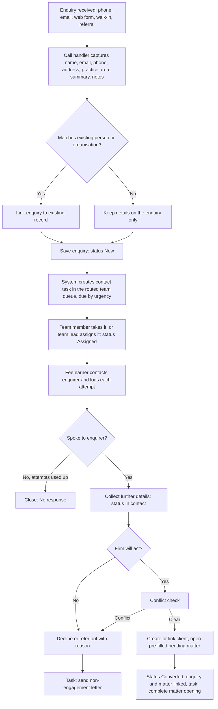

# 1Squared – Enquiries & Tasks: Build Prompt for Antigravity

Oct 17, 2026 · @Someone

## How to use this with Antigravity

Everything from **The prompt** onwards is written to Antigravity. Export this doc as Markdown, save it in the project as `docs/enquiries-and-tasks.md`, then give Antigravity this instruction:

> Read `docs/enquiries-and-tasks.md` in full. Inspect the existing codebase first, then reply with an implementation plan before changing any code.

The drawn process flow is for people reading this doc. Antigravity gets the same flow as a Mermaid diagram inside the prompt, which survives the Markdown export.

## The prompt

You are adding two connected modules to 1Squared, a practice management application for a UK law firm: **Enquiries** (pre-engagement intake) and **Tasks** (work assigned to people and teams). The People & Organisations and Matters modules already exist. Build on them; do not rebuild or restyle them.

### Before you write code

1. Inspect the codebase. Find how People, Organisations and Matters store data, render lists and forms, handle picklists (admin-managed lists), record the audit trail, search, and route between pages.
2. Reuse those patterns, components and styles. New screens must look and behave like the existing ones.
3. Existing saved data must survive. Add any new collections or fields through a migration, never by resetting data.
4. Reply with an implementation plan in the build order below, listing the files you will create or change. Wait for my approval before implementing.
5. After each build step, run the app and check that step against the acceptance criteria before moving on.

### Goal

A call handler takes an enquiry in under two minutes, and it reaches the right team as a task straight away. A team member takes or is assigned that task, contacts the enquirer, and either converts the enquiry into a pending matter or closes it with a recorded reason. Nothing is lost between the phone call and the matter.

### Worked example

Someone phones about being dismissed from work. The call handler records their name, email, phone, address, practice area **Employment & HR** and a few lines of high-level notes. Saving it creates enquiry ENQ-000012 and a task, *Contact new enquiry: Sam Jones*, in the Employment team queue. An Employment associate takes the task, calls Sam, logs the call and collects more detail. The conflict check is clear, so the associate converts the enquiry. That creates Sam as a person and a pending **Tribunal claims** matter pre-filled from the enquiry.

### In scope

- Teams: create teams, add members, set team leads, map teams to practice areas for routing.
- Tasks: create, assign to a person or a team, take from a team queue, reassign, complete, comment, link to any record.
- Enquiries: quick capture, duplicate check, routing to a team, contact log, status lifecycle, conversion to a matter, decline or referral.
- Automatic tasks raised by enquiry events.
- In-app notifications, Home page alerts, admin settings and demo data.

### Out of scope for this build

- Sending emails or SMS from the app (show `mailto:` and `tel:` links only).
- A public web form. Model the **Web form** channel so one can be connected later.
- Telephony integration and call recording.

## Process flow

&#91;embedded content: enquiry to matter flow · 3 roles, 1 decision\]

The call handler only captures and saves. The system raises the team task, and the fee earner who takes it owns the enquiry until it converts or closes.

The same flow for Antigravity, with statuses:

## Enquiry record

An enquiry is a separate record from a person. It holds the caller's details as given, so nothing is added to People until the enquiry is linked or converted.

### Fields

| Field | Type | At capture | Notes |
| --- | --- | --- | --- |
| Reference | Auto | System | Format `ENQ-000001` |
| Received | Date and time | System | Defaults to now; editable for enquiries logged later |
| Taken by | Employee link | System | Defaults to the current user |
| Channel | Picklist | Required | Phone, Email, Web form, Walk-in, Referral, Existing client |
| First name, last name | Text | Required |  |
| Calling on behalf of | Text, or link to an organisation | Optional | For enquiries made for a business |
| Email | Email | One of email or phone required | Validate format |
| Phone | Phone | One of email or phone required |  |
| Preferred contact method and best time | Picklist + text | Optional |  |
| Address | Line 1, line 2, town, postcode, country | Requested | Reuse the address component from People; the caller may decline |
| Practice area | Picklist (taxonomy Axis 1) | Required | Drives routing to a team |
| Work type | Picklist, filtered by practice area | Optional | Call handlers often won't know; the fee earner sets it later |
| Summary | Text, 120 characters | Required | Shown in lists, e.g. *Dismissed last week, wants advice* |
| Notes | Long text | Required | High-level facts only (see Compliance) |
| Other parties named | Text | Optional | e.g. the employer; used for the conflict pre-check |
| Urgency | Picklist | Required | Standard (default), Urgent, Emergency |
| Key date mentioned | Date + label | Optional | e.g. *Dismissal date*; shown prominently to the fee earner |
| How they heard of us | Picklist (taxonomy Axis 7 source) | Optional | Referrer contact link when it is a referral |
| Privacy notice given | Yes / No | Required | Call handler confirms the privacy notice was read or sent |
| Linked person / organisation | Links | System | Set by the duplicate check or on conversion |
| Assigned team | Team link | System | From practice area routing; editable |
| Assigned to | Employee link | Set on assignment |  |
| Status | See below | System |  |
| Next action date | Date | Optional |  |
| Close reason | Picklist | Required when closing | Conflict, Outside our expertise, Not commercially viable, Client went elsewhere, No response, Referred out, Other |
| Referred to | Organisation link | When referred out |  |
| Converted matter | Matter link | Set on conversion |  |
| Contact log | Child records |  | Date and time, method (Call, Email, Voicemail, Meeting), outcome (Spoke, No answer, Left message, Email sent), note, by |

### Statuses

| Status | Meaning | Set by |
| --- | --- | --- |
| New | Captured and routed to a team, nobody assigned yet | System on save |
| Assigned | A named person owns it | Taking or assigning the task |
| In contact | The enquirer has been spoken to | Logging a contact with outcome *Spoke* |
| Converted | A matter has been created from it | Convert action |
| Declined | The firm will not act | Decline action, with a reason |
| Referred out | Passed to another firm or service | Refer action, with *Referred to* |
| No response | Contact attempts used up with no reply | Close action, or automatically after the set number of attempts |

Converted, Declined, Referred out and No response are closed statuses. A closed enquiry can be reopened by its assignee, a team lead or an admin, which returns it to Assigned and is logged.

## Tasks and teams

Tasks are a general module, not part of Enquiries. Any record (enquiry, matter, person, organisation) can have tasks, and any user can create one and assign it to a person or a team.

### Team record

| Field | Type | Notes |
| --- | --- | --- |
| Name | Text | e.g. Employment & HR |
| Description | Text |  |
| Members | Employee links | An employee can belong to several teams |
| Team leads | Employee links | Must also be members; can assign and reassign the team's work |
| Practice areas routed here | Multi-picklist (taxonomy Axis 1) | Each practice area routes to one team only; warn on clashes |
| Active | Yes / No | Inactive teams cannot receive new work |

Seed one team per practice area plus **Intake** (call handlers), **Risk & Compliance** and **Accounts**. Place existing demo employees in teams; the Employment & HR team needs at least two members and a lead.

### Task record

| Field | Type | Notes |
| --- | --- | --- |
| Reference | Auto | `TSK-000001` |
| Title | Text | Required |
| Description | Long text |  |
| Task type | Picklist (admin list) | Call back, Follow up, Send letter, Conflict check, Review, Complete matter opening, General |
| Priority | Picklist | Low, Normal (default), High, Urgent |
| Due | Date, optional time | Required |
| Assigned to team | Team link | Either team, person, or both |
| Assigned to person | Employee link | Either team, person, or both |
| Status | Picklist | To do, In progress, Waiting, Done, Cancelled |
| Linked records | Links | One or more of enquiry, matter, person, organisation |
| Created by / at | System |  |
| Completed by / at | System | Set when status becomes Done |
| Comments | Child records | Threaded under the task, with author and time |
| History | Audit trail | Every assignment, status and due-date change |

### Assignment rules

1. **Team only.** The task sits in that team's queue and every member sees it. Any member can **Take** it, which assigns it to them and keeps the team for reporting. A team lead can **Assign** it to a member.
2. **Person only.** The task appears in that person's *My tasks*. Their teams don't see it.
3. **Team and person.** It appears in *My tasks* and in the team view under that person's name, so the lead can see who holds what.
4. **Reassign.** The creator, the assignee, a lead of the assigned team or an admin can reassign. Each change is logged and the new assignee is notified.
5. **Overdue.** A task past its due time and not Done or Cancelled is overdue. It shows in red for the assignee and in the team lead's view.
6. **Unclaimed.** A team-only task not taken within its response time is flagged to the team leads.

### Automatic tasks

| Trigger | Task | Assigned to | Due |
| --- | --- | --- | --- |
| Enquiry saved | Contact new enquiry: *name* (type Call back) | Routed team | From the urgency response time |
| Enquiry assigned to someone | The open contact task moves to them | That person | Unchanged |
| Enquiry declined or referred out | Send non-engagement letter | Enquiry assignee | 2 working days |
| Enquiry converted | Complete matter opening | Matter lead fee earner | 5 working days |

When an enquiry closes, its open contact task is completed automatically and the history says why. Automatic task titles, types and due offsets are admin settings.

### Response times (suggested defaults, admin-editable)

| Urgency | First contact due |
| --- | --- |
| Emergency | Within 2 working hours |
| Urgent | End of the same working day |
| Standard | End of the next working day |

Working hours default to 09:00–17:30, Monday to Friday, excluding bank holidays for England and Wales.

## Screens and behaviour

### Navigation

- Add **Enquiries** and **Tasks** to the side rail. Tasks shows a badge with the user's overdue plus due-today count.
- Add **New enquiry** and **New task** to the *+ New* menu.
- Include enquiries and tasks in global search (name, reference, email, phone, summary).

### New enquiry (call handler)

- One short form a call handler can complete while on the phone, keyboard-only, in this order: caller, contact details, address, enquiry details.
- Show a fixed reminder at the top: *Take high-level details only. Do not give legal advice or take confidential detail before a conflict check.*
- As name, email or phone are typed, search existing People and Organisations and show possible matches. The handler can link a match or carry on.
- If the other parties named match an existing client, show a warning without blocking the save.
- **Save** confirms *ENQ-000012 sent to the Employment & HR team* and opens the enquiry. **Save and add another** clears the form for the next call.
- If the practice area maps to no active team, save to the **Intake** team queue and flag it.

### Enquiries list

- Tabs: **Team queue** (unassigned, for my teams), **Mine**, **All open**, **Closed**.
- Columns: reference, name, practice area, summary, urgency, received, age, assigned to, status, next action.
- Filters for practice area, team, urgency, status and channel. Sort oldest first in the queue, Emergency and Urgent at the top.

### Enquiry page

- Header: name, reference, status, urgency, practice area, key date with a countdown, and `tel:` / `mailto:` buttons.
- Actions as the status allows: **Take**, **Assign**, **Log contact**, **Convert to matter**, **Decline**, **Refer out**, **Close – no response**, **Reopen**.
- Sections: details (editable), contact log (newest first), linked tasks with a **New task** button, activity and audit trail.
- Logging a contact with outcome *Spoke* moves the status to In contact.
- After the set number of failed attempts (default 3) without a *Spoke* outcome, suggest closing as No response. Never close automatically without confirmation.

### Tasks

- **My tasks**: overdue, today, this week, later, plus a **Done** view.
- **Team tasks**: one section per team I belong to, split into unclaimed and claimed by person. Team leads see filters by member and overdue.
- **Created by me**: tasks I assigned to others, with status, so I can chase them.
- Each task row has quick actions: Take, Start, Complete, Reassign, change due date. Clicking opens the task with its description, linked records, comments and history.
- Records with tasks (enquiry, matter, person, organisation) show a **Tasks** section with open tasks and a **New task** button that pre-links the record.

### Home page

- **Needs attention** adds: my overdue tasks, unclaimed urgent or emergency enquiries in my teams, and enquiries past their first-contact time.
- Team leads also see a count of unclaimed and overdue items per team.

### Notifications

- In-app only: a bell in the header with an unread count and a list.
- Notify when a task is assigned or reassigned to me, a task assigned to my team arrives, a comment is added to my task, an enquiry is assigned to me, or a task of mine becomes overdue.

### Admin

- **Teams**: create, edit, deactivate; members, leads and practice-area routing.
- **Enquiry settings**: response time per urgency, working hours, failed attempts before suggesting No response, close reasons, channels, retention period.
- **Task settings**: task types, priorities, automatic task titles and due offsets.
- Picklists use the existing admin list mechanism.

### Roles

Use the existing user model and add a role field if none exists: **Call handler** (create enquiries and tasks, view enquiries they took), **Fee earner**, **Team lead**, **Admin**. Keep enforcement simple in this build: hide actions the role cannot use, and record who did what.

## Conversion, compliance and acceptance

### Converting an enquiry to a matter

1. **Client.** Link the existing person or organisation found by the duplicate check, or create a new person pre-filled from the enquiry: name, email, phone, address, source and referrer. For a business, create or link the organisation and add the caller as a contact.
2. **Conflict check.** Run the existing conflict search against the client and the other parties named. A conflict blocks conversion and offers **Decline** with reason *Conflict*.
3. **Matter.** Open the existing New matter form with these pre-filled: client, work type (or practice area if no work type yet), instructions from the notes, source, other parties, instructing contact, and the key date if a matching key date field exists for that work type.
4. **Save.** The matter saves as *Pending* through the normal matter rules. The enquiry becomes Converted and links both ways: the matter shows *Created from ENQ-000012*.
5. **Follow-up.** The automatic *Complete matter opening* task is raised.

### Compliance

- **Before a conflict check**, enquiry notes carry high-level facts only. The capture form says so and the notes placeholder repeats it.
- **Privacy.** The privacy notice confirmation is required. Enquiries that never convert are anonymised after the retention period: personal details are removed, while practice area, channel, dates and outcome are kept for reporting. The firm sets the period; until it does, use 12 months as a placeholder.
- **Non-engagement.** Declined and referred-out enquiries always raise the *Send non-engagement letter* task, so the firm can show it told the enquirer it is not acting.
- **Audit.** Every create, assignment, status change, contact log entry and conversion is recorded with who and when, matching the existing audit trail.

### Demo data

Seed eight enquiries across statuses and practice areas, including three in Employment & HR: one New and unclaimed, one Assigned with two failed contact attempts, one Converted to a pending Tribunal claims matter. Seed around fifteen tasks across people and teams, including overdue and unclaimed ones.

### Build order

1. Teams and admin.
2. Tasks: model, My tasks, Team tasks, task page, record task sections.
3. Enquiries: capture form, list, enquiry page, contact log.
4. Routing, automatic tasks and response times.
5. Conversion to a matter.
6. Home page, notifications, search and the rail badge.
7. Demo data and migration of existing saved data.

### Acceptance criteria

- [ ] A call handler can record a phone enquiry with name, email, phone, address, practice area, summary and notes in under two minutes using only the keyboard.
- [ ] Saving an Employment & HR enquiry creates a contact task in the Employment & HR team queue with the right due time for its urgency.
- [ ] Every Employment & HR team member sees the unclaimed task; one takes it and it moves to their *My tasks*, with the enquiry status changing to Assigned.
- [ ] A team lead can assign the task to a named member, who is notified.
- [ ] Anyone can create a task from the Tasks page or a record, assign it to a person, a team or both, and it appears in the right views.
- [ ] Logging a contact with outcome *Spoke* sets the enquiry to In contact.
- [ ] Converting creates or links the client, runs the conflict check, opens a pre-filled pending matter, and links enquiry and matter both ways.
- [ ] Declining or referring out requires a reason and raises the non-engagement letter task.
- [ ] Overdue tasks and late first contacts appear on Home and in the team lead's view.
- [ ] Typing a known email or phone number on the capture form shows the matching person.
- [ ] Existing people, organisations and matters are untouched after the update.
- [ ] All new screens match the existing look, including dark mode and mobile widths.

### Open questions for the firm

- How long should unconverted enquiries be kept before anonymising?
- Should call handlers see enquiries taken by others?
- Are the suggested first-contact times right for each urgency?
