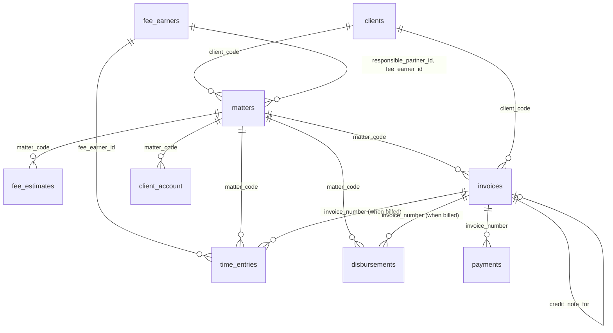

# 1Squared – PMS Financial Data: Build Prompt for Antigravity

Oct 17, 2026 · @Someone

## How to use this with Antigravity

You need two files in the project: the workbook `1Squared_PMS_Demo_Data.xlsx` and this doc exported as Markdown.

1. Save the workbook as `data/pms/1Squared_PMS_Demo_Data.xlsx`.
2. Export this doc as Markdown and save it as `docs/pms-financial-data.md`.
3. Give Antigravity this instruction:

> Read `docs/pms-financial-data.md` in full and open `data/pms/1Squared_PMS_Demo_Data.xlsx`. Inspect the existing codebase, then reply with an implementation plan before changing any code.

Everything from **The prompt** onwards is written to Antigravity. The drawn data diagram is for people reading this doc; Antigravity gets the same structure as a Mermaid diagram that survives the export.

## The prompt

You are connecting 1Squared to financial data from a practice management system (PMS). 1Squared is a law firm application with People & Organisations and Matters modules already built. The PMS is the firm's system of record for time, billing and money. 1Squared reads from it and never writes to it.

There is no live PMS for this demo. Build a separate demo database from `data/pms/1Squared_PMS_Demo_Data.xlsx` and connect 1Squared to it in a way that can later be pointed at a real PMS, through its API or a replicated reporting database.

### Before you write code

1. Inspect the codebase: how data is stored and loaded, how records are linked, how profile tabs, lists and the Home page are built, and how styling and number formatting work.
2. Open the workbook. Read the `README` and `data_dictionary` sheets before the data sheets.
3. Reply with an implementation plan in the build order below, listing files to create or change, the database engine you will use and why. Wait for my approval.
4. After each build step, check the results against the workbook's `check_` sheets before moving on.

### Goal

A fee earner opening a matter or client in 1Squared sees its financial position from the PMS without leaving the app. This includes time recorded, unbilled work in progress (WIP), bills, payments, debt, fee estimate used and client account balance. Every figure must equal the workbook's check sheets.

### Integration approach

- **Separate store.** The PMS demo database is its own database, never tables inside 1Squared's store. Prefer SQLite for the demo unless the project already uses a database engine that suits better.
- **Adapter layer.** All PMS reads go through one interface, for example `PmsSource`, with methods such as `getMatterFinancials(matterCode)`, `getClientFinancials(clientCode)`, `getTimeEntries(matterCode, filters)`, `getInvoices(...)`, `getAgedDebt(...)`. Implement it once as `DemoDbPmsSource`. A later `ApiPmsSource` or `ReportingDbPmsSource` must be a drop-in replacement, so no screen queries the database directly.
- **Read only.** 1Squared shows PMS data and links to it. It does not edit time, bills or payments.
- **Links, not copies.** 1Squared stores only the link between its records and PMS codes (see Building the database). Financial figures are read from the PMS source each time, never copied into 1Squared records.
- **As-at date.** The extract is dated 16 October 2026. Store it in an `extract_info` table and age debt and WIP against that date, not today, so the demo stays consistent. Show *PMS data as at 16 Oct 2026* wherever PMS figures appear.

### In scope

- An import script that builds the demo database from the workbook and can be re-run safely.
- Derived views for matter, client, aged debt and fee earner figures.
- Record matching between 1Squared and the PMS, plus an admin screen for unmatched records.
- Finance tabs and sections on matters, organisations, people and the Home page.

### Out of scope

- Writing to the PMS, raising bills, recording time or payments.
- Connecting to a real PMS. Design for it, don't build it.

## The data

&#91;embedded content: PMS demo tables and their links to 1Squared\]

Arrows run from a record to the records that belong to it. Invoices, payments and client account rows also carry `matter_code` and `client_code`; time entries carry `fee_earner_id`. The dashed lines are the only connections between 1Squared and the PMS.

The same structure for Antigravity:

## Building the database

### Import

- Import only the nine data sheets: `fee_earners`, `clients`, `matters`, `fee_estimates`, `time_entries`, `disbursements`, `invoices`, `payments`, `client_account`. Skip `README`, `data_dictionary` and every `check_` sheet.
- Row 1 holds the column names; data starts at row 2. Use the sheet name as the table name and the column names as they are.
- Types come from `data_dictionary`: dates as dates, money as decimal with 2 places (never floating point), percentages as fractions.
- Create primary and foreign keys as listed. Fail the import with a clear message if a foreign key has no match.
- The script drops and rebuilds the demo database each run, then records the run time and as-at date in `extract_info`.
- Add indexes on every `matter_code`, `client_code`, `fee_earner_id` and `invoice_number` column.

### Derived views

Calculate these in the database, not in the screens. They must reproduce the check sheets exactly.

| View | One row per | Figures | Check against |
| --- | --- | --- | --- |
| `v_matter_financials` | Matter | Fee estimate, time value recorded, unbilled WIP, fees billed, disbursements billed, total invoiced incl. VAT, paid, outstanding, unbilled disbursements, estimate used %, written off, client account balance | `check_matters` |
| `v_invoice_balances` | Invoice | Total, paid, credit notes applied, outstanding, days past due at the as-at date, age bucket (Not yet due, 1-30, 31-60, 61-90, 90+) | `check_aged_debt` |
| `v_client_financials` | Client | Sum of the matter figures, aged debt by bucket, credit limit used % | `check_aged_debt` (client table) |
| `v_fee_earner_performance` | Fee earner | Chargeable hours, time value, billed value, written off, annual target hours | `check_fee_earners` |

Definitions to apply:

- **Unbilled WIP** = sum of `time_entries.value` where `billed_status` = Unbilled.
- **Outstanding** = invoice total − payments + credit notes (credit notes are negative and point at the invoice through `credit_note_for`). Recalculate invoice status from this; don't trust the exported `status`.
- **Estimate used %** = (fees billed + unbilled WIP) ÷ current fee estimate. The current estimate is the latest `fee_estimates` row for the matter. Warn at the matter's `estimate_alert_pct`, alert at 100%.
- **Capped fees**: also show time value recorded against the cap, since time can run past it.
- **Client account balance** = sum of `client_account.amount` for the matter.

### Matching to 1Squared

Create a link table in 1Squared's own store, for example `pms_links (entity_type, onesquared_id, pms_code, matched_by, matched_at)`.

| 1Squared record | PMS record | Automatic match | If no match |
| --- | --- | --- | --- |
| Organisation | `clients` (Organisation) | `company_number` = registration number | List as unmatched |
| Person | `clients` (Individual) | `email` = any of the person's emails | List as unmatched |
| Employee | `fee_earners` | `email` = work email | List as unmatched |
| Matter | `matters` | None; suggest candidates with the same linked client and a similar description | Link by hand |

Add an admin screen, **PMS links**, listing matched and unmatched records of each kind. It offers suggested matches, lets an admin link or unlink by hand, and can **create a 1Squared record from a PMS record** (for example, fee earners FE004, FE007 and FE008 are not yet 1Squared employees). Re-running automatic matching never overwrites a manual link.

The workbook's README notes which demo matters already exist in 1Squared (Penarth lease, Price purchase, Pugh estate, Brightwater tribunal claim). Expect the rest to be PMS-only until linked or created.

## Screens

Every PMS figure carries a small *PMS* label and the *as at 16 Oct 2026* date. If a 1Squared record has no PMS link, show *Not linked to the PMS* with a **Link** button for admins, never zeros.

### Matter page: new Finance tab

- **Headline figures:** unbilled WIP, fees billed, paid, outstanding, client account balance, and unbilled disbursements.
- **Fee estimate bar:** billed and WIP stacked against the current estimate, the alert line at `estimate_alert_pct`, amber past the alert, red past 100%. Capped fees also show time recorded against the cap. Retainers show billed to date against the annual value.
- **Estimate history:** each estimate and revision with date, amount, reason and client acceptance. A revision awaiting acceptance is flagged.
- **Time:** table of entries, newest first, with date, fee earner, activity, narrative, hours, rate, value and status. Filters for fee earner, status and date range, with totals for the filtered rows. Also show WIP by fee earner and WIP age (0-30, 31-60, 61-90, 90+ days by entry date).
- **Bills:** invoices and credit notes with date, type, fees, disbursements, VAT, total, paid, outstanding and recalculated status. Expanding a bill shows its payments and the time and disbursements it covered.
- **Disbursements:** each one with billed status and whether it was paid from office or client account.
- **Client account:** the ledger with a running balance.
- The **Overview** tab gains one line: *WIP £x · Outstanding £y · z% of estimate*.

### Organisation and person pages: Finance section

- Totals across the client's PMS matters: WIP, billed this year, paid, outstanding, client account held.
- Aged debt as a single stacked bar by bucket, plus credit limit used where a limit is set.
- A list of the client's PMS matters with WIP, outstanding and estimate used %. Matters not yet in 1Squared show a **Create matter in 1Squared** action for admins.
- **Group view:** for an organisation with subsidiaries in 1Squared (Severn Holdings plc owns Severn Logistics and Severn Freight Services), show the group total and each company's share.

### Matters list

Add optional columns for WIP, outstanding and estimate used %, sortable, with the alert colours.

### Home page

- **Needs attention** adds PMS alerts for matters I am partner or lead on:
  - over the estimate alert or over 100%;
  - capped fee time past the cap;
  - bills over 60 days past due;
  - unbilled WIP older than 30 days;
  - revised estimates awaiting client acceptance.
- A **My figures** panel for the signed-in employee, if linked to a fee earner: chargeable hours this month and year to date, WIP, and billed this year. Because the extract is a sample of matters, show hours as a figure, not as a percentage of target.

### Formatting and access

- Money in GBP with £ and 2 decimals; negatives in brackets; percentages to whole numbers.
- Dark mode and mobile widths must work, as on existing screens.
- Finance views are visible to fee earners, partners, finance and admins. Hide them from the Call handler role if roles exist.

## Build order and acceptance

### Build order

1. Import script, demo database, `extract_info`, keys and indexes.
2. Derived views, verified against the three `check_` sheets.
3. The `PmsSource` interface and `DemoDbPmsSource`.
4. The `pms_links` table, automatic matching and the PMS links admin screen.
5. Matter Finance tab and Overview line.
6. Organisation and person Finance sections, including the group view.
7. Matters list columns, Home page alerts and My figures.

### Acceptance criteria

- [ ] The import builds the database from the workbook with no errors, and running it twice gives the same result.
- [ ] Totals across all matters match `check_matters`: unbilled WIP £34,140.00, outstanding debt £49,130.22, client account £118,454.20.
- [ ] BRI001-0003 (Afon Care Homes acquisition) shows WIP £11,057.00, outstanding £22,637.40 and 73% of its £72,000 estimate, with the revised estimate flagged as awaiting acceptance.
- [ ] SEV001-0001 shows £27,984.00 of time recorded against a £25,000 cap and raises a Home alert.
- [ ] Bay Cafés Ltd shows £3,300.00 in the 90+ bucket and £1,080.00 in 1-30, ageing at 16 Oct 2026.
- [ ] Invoice statuses are recalculated from payments and credit notes; PEN001-0003's final bill shows as paid after its credit note.
- [ ] The Pugh estate shows a client account balance of £33,510.60 with a running-balance ledger.
- [ ] Every 1Squared organisation and person with a matching company number or email is linked automatically, and unmatched PMS records appear on the PMS links screen.
- [ ] Severn Holdings plc shows group totals across its two subsidiaries.
- [ ] A 1Squared record with no PMS link shows *Not linked to the PMS*, not zeros.
- [ ] No screen queries the PMS database directly; everything goes through `PmsSource`.
- [ ] Existing 1Squared data and screens are unchanged apart from the new Finance areas.

### Later, not now

For a live PMS, add an `ApiPmsSource` or `ReportingDbPmsSource`, a scheduled refresh, and caching with the *as at* time taken from the last sync.
