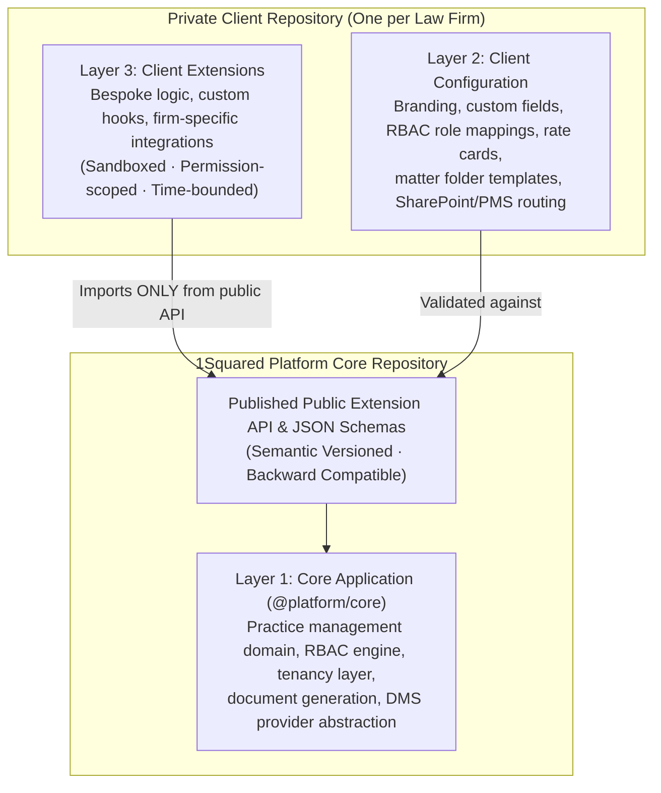
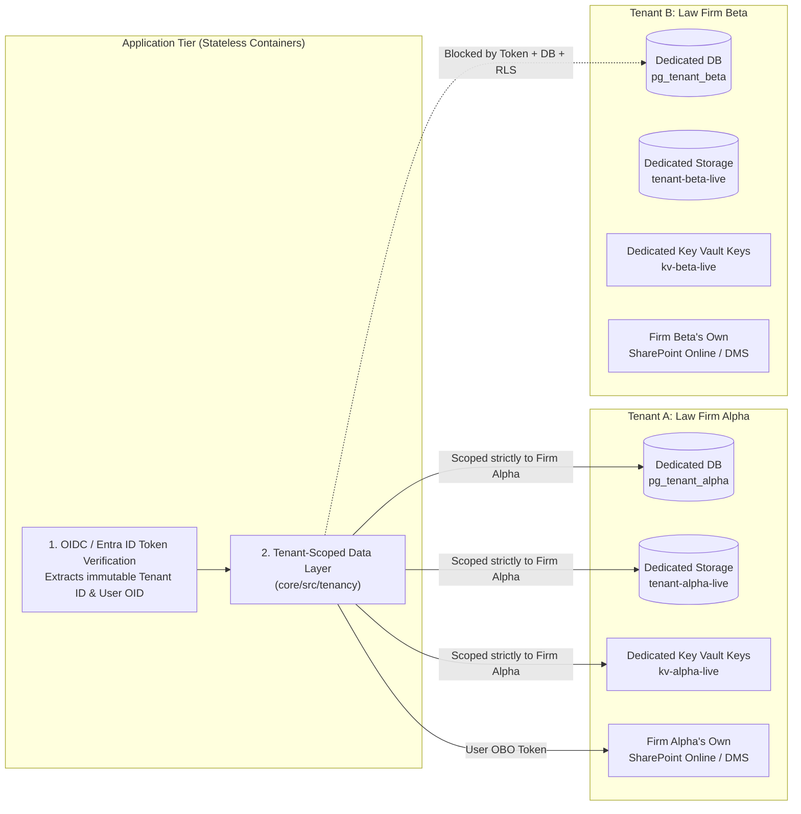
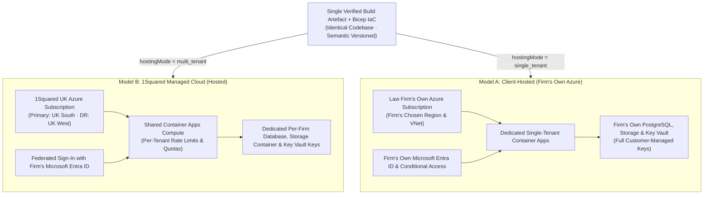

# 1Squared — Deployment Models, Customisation & Security Architecture Guide

*A reference guide for client presentations, IT/InfoSec due diligence questionnaires, and slide decks.*

---

## Executive Summary (The 30-Second Pitch for Law Firms)

Law firms face a false choice with legal software: either buy a **rigid SaaS product** where every firm's data is mingled in one giant database and bespoke changes are impossible, or buy a **bespoke/custom-forked system** that becomes un-upgradeable, insecure, and expensive to maintain.

**1Squared solves this through three architectural guarantees:**
1. **One Core, Three Clean Layers:** Everyone runs the exact same, continuously upgraded **Core Application**, while each firm's **Configuration** (fields, workflows, RBAC, folder templates) and **Bespoke Extensions** (custom logic, PMS/DMS adapters, firm-specific screens) live in a **dedicated private repository per client**—never in the core and never shared with other firms.
2. **Database-Per-Tenant Isolation:** Even in our hosted service, **your firm's data is never mingled in a shared database table with another law firm**. Every client gets a dedicated PostgreSQL database, a dedicated storage container, and dedicated encryption keys in Azure Key Vault.
3. **Your Choice of Hosting (Same Build, Either Model):** The exact same container image can run in **1Squared's UK-hosted cloud (Model B)** or inside **your firm's own Microsoft Azure subscription (Model A)**—and you can move between them without rewriting a single line of code.

---

## 1. How the Application is Structured: The Three-Layer Architecture

To ensure that one client's custom work never leaks to another client—and never blocks platform upgrades—1Squared strictly separates every deployment into three layers:

| Layer | What Lives Here | Where It Is Stored | Who Can Change It | How It Upgrades |
| :--- | :--- | :--- | :--- | :--- |
| **Layer 1: Core Application** | Standard practice management features, matter/client data model, RBAC engine, SharePoint/DMS integration, security & tenancy enforcement. | Central private `core` repository. Contains **zero** client names, IDs, or client-specific `if` statements (enforced by automated CI checks). | 1Squared Platform Engineering only. | Semantic versioning (`MAJOR.MINOR.PATCH`), rolled out to all clients. |
| **Layer 2: Client Configuration** | Firm branding, custom fields & screen placement, choice lists, RBAC role & Entra group mappings, rate cards, cost thresholds, SharePoint routing & matter folder templates. | Stored as tenant-scoped data + version-controlled in the firm's own private `client-<firm>` repository (`config/base.json` + environment overlays for `dev`, `test`, `training`, `live`). | Trained Firm Administrators (via Admin UI) or 1Squared Onboarding Team. | Validated automatically against the Core JSON Schema; requires **zero code redeploy** when changed. |
| **Layer 3: Bespoke Client Extensions** | Genuinely bespoke firm logic—custom fee/partner sign-off rules, custom merge-field providers, bespoke billing/PMS hooks, custom validations. | Packaged in the firm's private `client-<firm>/extensions/` repository. | 1Squared Engineering (or approved partner developers) against the published Extension API. | Runs inside a **Sandboxed Extension Host** with strict permissions, timeouts, and error isolation. |

### Why Law Firm CIOs Love the Extension Sandbox
- **No "Spaghetti Code" or Forks:** Bespoke code for Firm A is physically absent from Firm B's repository and runtime context.
- **Permission-Gated:** Every extension must declare a `manifest.json` listing its exact permissions (e.g., `matter:read`, `finance:view`). It receives a **read-only, tenant-scoped context**—never a raw database connection, and never access to HR/payroll sensitive fields.
- **Fault-Isolated:** Every extension hook runs with a strict execution timeout (e.g., 500ms–2,000ms). If a bespoke extension throws an error or times out, the Extension Host catches and isolates it so the core platform never goes down.

---

## 2. How Databases & Storage Work: True Data Separation

Because law firms hold legally privileged, confidential, and regulated personal data (SRA, GDPR, AML/CDD), 1Squared mandates **physical data separation per tenant** rather than relying solely on application `WHERE` clauses.

### Five Layers of Database & Storage Protection
1. **Dedicated Database Per Client (`pg_tenant_<slug>_<env>`):**
   - Each firm's structured records (matters, clients, enquiries, tasks, financial summaries, audit logs) live in that firm's own dedicated PostgreSQL database.
   - Independent backups and point-in-time recovery: restoring or migrating one firm's database **never touches another firm**.
2. **Database-Enforced Row-Level Security (RLS) as a Second Lock:**
   - Even inside the tenant database, tables enforce `ENABLE ROW LEVEL SECURITY` (`FORCE ROW LEVEL SECURITY`) checking `current_setting('app.current_tenant_id')`. Even if a developer wrote a buggy query, the database engine itself refuses to return rows without a matching tenant session claim.
3. **Token-Derived Tenant Identity (Zero Trust on Request Input):**
   - The active tenant is resolved **exclusively** from the cryptographically verified Microsoft Entra ID OIDC token (`tid` / `tenantId`), **never** from a URL parameter, HTTP header, or form field that a user could tamper with. Any mismatch between the token and request immediately throws `TENANCY_FORGERY_DETECTED`.
4. **Dedicated Storage Container & Encryption Keys Per Client:**
   - Templates and generated snapshots live in a dedicated Azure Blob Storage container per tenant (`tenant-<slug>-<env>`) protected by Microsoft Defender for Storage on-upload malware scanning and short-lived, tenant-bound download tokens.
   - Each tenant has separate secrets and encryption keys in Azure Key Vault (`kv-<slug>-<env>`), with support for **Customer-Managed Keys (CMK)**.
5. **Zero-Copy External Document Store (SharePoint Online / DMS):**
   - Matter documents remain inside **the law firm's own SharePoint Online tenancy**.
   - 1Squared stores only folder references (`siteId`, `driveId`, `itemId`)—never copies of your client files.
   - When a fee earner views, uploads, or edits a document in 1Squared, 1Squared uses Microsoft Graph **On-Behalf-Of (OBO)** delegated authentication so **SharePoint enforces that individual user's own permissions** and records their name in your firm's Microsoft Purview / SharePoint audit trail.

---

## 3. The Two Hosting Models: Hosted by 1Squared vs. Client Self-Hosted

1Squared is built so that **tenancy mode is configuration, not code**. The exact same container build (`single_tenant` vs `multi_tenant`) and the exact same Azure Bicep Infrastructure-as-Code templates (`core/infra/main.bicep`) power both deployment models.

### Side-by-Side Comparison for Prospective Clients

| Dimension | **Model B: 1Squared Hosted Cloud** *(Most Popular)* | **Model A: Client-Hosted (Your Azure Tenancy)** |
| :--- | :--- | :--- |
| **Best For** | Firms wanting a turnkey, fully managed UK cloud service with dedicated database isolation and zero infrastructure overhead. | Firms with strict regulatory, sovereign, or institutional client mandates requiring all infrastructure inside their own Azure subscription. |
| **Tenancy Mode** | `multi_tenant` (Shared stateless compute; **dedicated database, storage container, and Key Vault keys per firm**). | `single_tenant` (100% dedicated compute, database, storage, network, and Key Vault inside the firm's Azure). |
| **Where Data Lives** | UK Azure Regions (**UK South** primary, **UK West** disaster recovery). Matter files stay in the firm's own SharePoint/DMS. | The firm's own Azure subscription and chosen region. Zero client data ever flows to 1Squared environments. |
| **Identity & SSO** | Federated with the firm's **Microsoft Entra ID** (OIDC, Conditional Access, MFA, Entra Security Groups). | Native to the firm's **Microsoft Entra ID** (supports Managed Identity inside the firm's Azure tenant). |
| **Encryption & Keys** | TLS 1.2+ in transit; AES-256 at rest; per-tenant keys in Key Vault (optional Customer-Managed Keys). | Firm owns the Azure Key Vault and all cryptographic keys outright. |
| **Upgrades & Releases** | Managed by 1Squared via release rings (`dev → test → training → live`) with zero-downtime backward-compatible migrations. | Upgraded on an agreed schedule with the firm's IT team (within a 2-minor-version support window), repeatable by script with full rollback. |
| **1Squared Support Access** | No standing access to client data. Break-glass, time-limited, audited access restricted to one tenant at a time. | Zero access by default. Time-limited, client-approved access only when requested (e.g., via Azure Lighthouse / Just-In-Time PIM). |
| **Portability** | Can migrate from **Model B → Model A** (or vice versa) at any time because the database schema, configuration JSON, and Bicep templates are identical. | Identical build and schema—no lock-in to a custom on-premise codebase. |

---

## 4. Defence-in-Depth Security Controls (What Protects Client Information)

When presenting to a firm's Risk Partner, COLP, or InfoSec team, highlight these **8 verifiable engineering controls**:

1. **Two-Tenant Automated Release Gate:**
   - Every pull request touching data access runs automated **Two-Tenant Isolation Tests** (`core/tests/isolation.test.ts` and `core/tests/document-store.test.ts`). The test suite spins up two separate law firm tenants, populates both, and proves that every API, query, search, file download, and background job returns **only** the calling tenant's data—even when attacked with tampered record IDs or forged tenant claims. A single failure blocks the release.
2. **Two-Identity SharePoint Security (User OBO vs. App Provisioning):**
   - User actions **never** run under a privileged service account. Browsing, downloading, and uploading files always use the signed-in lawyer's own Microsoft Entra identity via On-Behalf-Of (OBO).
   - Background folder creation uses an app-only certificate stored in Key Vault with `Sites.Selected`—meaning the app can only touch the specific SharePoint library the firm's IT admin explicitly authorises, never `Sites.FullControl.All`.
3. **Ethical Walls & Restricted Staff Matters Built In:**
   - When a matter is flagged as a **Staff Matter** or **Ethical Wall / Restricted Matter**, 1Squared automatically restricts visibility in the application **and** breaks folder inheritance in SharePoint so only the named fee earners and authorised Risk/Compliance oversight roles have access.
   - Scheduled **Permission Reconciliation** continuously checks SharePoint for permission drift (such as someone manually sharing a restricted folder in SharePoint) and alerts administrators to remediate it with one click.
4. **Zero Client Data in Logs, Telemetry, or Code:**
   - Application logs and telemetry record only correlation IDs, tenant IDs, and opaque provider item IDs—**never** client names, matter descriptions, personal data, or document file names.
5. **Central RBAC with Multi-Factor Authentication (MFA) Enforcement:**
   - 32 granular permissions across Practice Management, HR/Payroll, Finance, Risk, Document Templates, and Document Stores.
   - High-sensitivity permissions (`admin:access`, `rbac:manage_config`, `rbac:manage_user_overrides`, `document_template:approve`, `document_store:configure`, `finance:manage_links`) verify that the user's Entra token carries a hardware or MFA authentication claim (`amr: ["mfa"]`) before executing.
   - Anti-escalation guards prevent any administrator from modifying their own permissions or granting a permission they do not hold themselves.
6. **Configurable AI Governance:**
   - AI features (`aiProviderChoice`) are configurable per tenant (`azure_openai_uk` or `disabled`), kept within UK Azure regions, and contractually and technically prevented from using any client content for model training.
7. **Four Isolated Environments Per Client (`dev`, `test`, `training`, `live`):**
   - Each environment has its own database, storage, and secrets. Live data is never copied to lower environments without anonymisation.
8. **Clean Offboarding Guarantee:**
   - Documented, scripted offboarding exports the firm's data and templates in open formats, then permanently deletes the tenant's database, storage container, and Key Vault keys with cryptographic confirmation.

---

## 5. Ready-to-Use Slide Deck Outline (8 Slides)

Use this structure to build your client-facing slide deck:

### Slide 1: Title — Built for Law Firm Confidentiality, Flexibility & Control
- **Headline:** One Modern Platform. Tailored to Your Firm. Isolated by Design.
- **Sub-headline:** How 1Squared delivers bespoke firm workflows without compromising upgradeability or client data security.
- **Visual:** Clean 3-pillar graphic: *1. Three-Layer Architecture* · *2. Dedicated Database Per Firm* · *3. Hosted or Self-Hosted Choice*.

### Slide 2: The Problem with Traditional Legal Software
- **Left Column (Legacy On-Prem / Custom Forks):** Customisations break every upgrade; stuck on old versions; high IT maintenance cost.
- **Middle Column (Generic Multi-Tenant SaaS):** All firms' data mixed in one database table; rigid "one-size-fits-all" workflows; documents copied into vendor cloud.
- **Right Column (The 1Squared Architecture):** Single continuously upgraded Core + isolated per-firm Configuration & Extensions + dedicated database per firm + documents stay in your SharePoint.

### Slide 3: The Three-Layer Architecture (How Customisation Works Safely)
- **Visual:** The Three-Layer diagram from Section 1 (`Core` ← `Configuration` ← `Sandboxed Extensions`).
- **Key Takeaways:**
  - **Core:** Upgraded seamlessly for all clients; zero client-specific code inside.
  - **Configuration:** Your custom fields, stages, RBAC roles, rate cards, and folder templates—stored as schema-validated data in your private repository.
  - **Extensions:** Bespoke firm integrations and rules running in a permission-scoped, fault-isolated sandbox.

### Slide 4: True Database & Storage Isolation (No Mingled Data)
- **Visual:** The Tenant Isolation diagram from Section 2 showing Firm Alpha and Firm Beta with separate databases, separate blob containers, and separate Key Vault keys.
- **Key Takeaways:**
  - Dedicated PostgreSQL database per firm (`pg_tenant_<firm>`).
  - Dedicated Azure Storage container & dedicated Key Vault encryption keys per firm.
  - Tenant identity locked to your Microsoft Entra ID token—never a URL or form field.
  - Independent per-firm backup, restore, and offboarding.

### Slide 5: Your Documents Stay in Your SharePoint / DMS
- **Visual:** Diagram showing Browser → 1Squared API → On-Behalf-Of (OBO) User Token → Firm's SharePoint Online.
- **Key Takeaways:**
  - **Zero-Copy Architecture:** 1Squared never stores copies of your matter files.
  - **Per-User Security:** Every lawyer views, uploads, and co-authors documents *as themselves* via Microsoft Entra ID.
  - **Least-Privilege Provisioning:** Matter folder templates (`{Department}/{Team}/{Matter}`) are provisioned automatically using `Sites.Selected`—scoped strictly to your chosen SharePoint library.
  - **Ethical Walls & Drift Detection:** Restricted matters automatically break inheritance, and background reconciliation detects any unauthorised permission changes in SharePoint.

### Slide 6: Choose Your Deployment Model — 1Squared Hosted (Model B) vs. Your Azure (Model A)
- **Visual:** The Model A vs. Model B comparison table from Section 3.
- **Key Takeaways:**
  - **Model B (1Squared UK Cloud):** Turnkey managed service in Azure UK South / UK West with dedicated database-per-firm isolation.
  - **Model A (Your Firm's Azure):** The exact same container image and Bicep infrastructure deployed directly inside your firm's Azure subscription.
  - **Freedom to Move:** Switch between Hosted and Self-Hosted at any time as your firm's regulatory needs evolve.

### Slide 7: Identity, RBAC & Compliance Controls
- **Key Takeaways:**
  - **Native Microsoft Entra ID SSO:** Uses your firm's Conditional Access policies, MFA, and Entra Security Groups.
  - **Granular RBAC + MFA Enforcement:** 32 permissions across Practice, Finance, HR, Risk, and Documents; critical admin actions require verified MFA claims and block self-escalation.
  - **Privacy-First Logging:** Logs carry correlation and tenant IDs only—never client names, personal data, or file names.
  - **Assurance Roadmap:** Aligned with UK GDPR, SRA confidentiality principles, Cyber Essentials Plus, and ISO 27001 controls.

### Slide 8: Continuous Assurance — Tested on Every Change
- **Visual:** Pipeline graphic: *Code Change → Static Zero-Client-Name Scan → Schema & Contract Tests → Two-Tenant Isolation Attack Tests → Staged Release Rings (`dev → test → training → live`)*.
- **Closing Message:** Security isn't a policy binder—it is enforced automatically on every build before any code reaches your environment.
