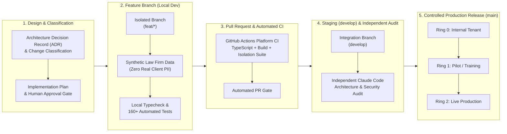

# 1Squared Software Engineering, Quality Assurance & Release Governance Guide

> **Purpose:** This document provides a comprehensive overview of 1Squared's Software Development Lifecycle (SDLC), Architecture-First design process, automated testing gates, dual-model AI verification (including independent **Claude Code** auditing on `develop` prior to production release), and ring-based deployment governance. It is structured so it can be shared directly with prospective law firm clients or adapted into a client-facing presentation deck.

---

## 1. Executive Summary: Why Engineering Process Matters to a Law Firm

For a law firm, a software update cannot be a leap of faith. A defect in a practice management platform risks breaching client confidentiality, disrupting court deadlines, or breaking firm-specific workflows.

1Squared is engineered around a **Zero-Trust, Architecture-First Software Development Lifecycle (SDLC)**. Every feature passes through **six independent quality and security gates** before it ever reaches a live environment:

1. **Architecture-First Specification (ADRs)**: Structural changes require formal Architecture Decision Records (`docs/decisions/`) and explicit classification before a single line of production code is written.
2. **Strict 10-Rule Platform Architecture Standard**: Enforced at both the code and compiler level (`AGENTS.md`, `CLAUDE.md`, and `docs/architecture-standard.md`).
3. **Isolated Feature-Branch Development**: Engineers never commit directly to `develop` or `main` (live). All work happens in isolated feature branches using 100% synthetic test fixtures (`Not A Law Firm LLP`).
4. **Automated CI Verification & Two-Tenant Isolation Testing**: Every commit runs automated TypeScript verification, contract tests, and adversarial **Two-Tenant Security Isolation Tests** (`.github/workflows/ci.yml`).
5. **Independent Multi-Model AI & Senior Developer Audit (`Claude Code`)**: Before changes in `develop` are promoted to `main` (live), an independent AI Senior Developer & Principal Architecture Reviewer (**Claude Code**) audits every modified file against the 10 Architecture Rules (`.github/workflows/claude-review.yml` + pre-release `develop` branch audit).
6. **Backward-Compatible Migrations & Ring-Based Rollout**: Database changes follow an **expand-then-contract** pattern so every release is instantaneously reversible without downtime.

---

## 2. End-to-End Development & Release Pipeline

---

## 3. Step-by-Step: How Every Feature Is Built and Verified

### Step 1: Change Classification & Architecture Decision Records (Before Coding)

No code is written ad-hoc. Before implementation begins, every request is formally classified under **Section 14 of the Platform Architecture Standard**:

| Change Class | What It Means | Mandatory Engineering Requirements |
| --- | --- | --- |
| **Core Feature** | New capability in `@platform/core` | Formal ADR (`docs/decisions/`), two-tenant isolation tests, reversible migration plan, user & admin documentation |
| **Core Extension Point** | New hook or public interface in `@platform/core/api` | Semantic versioning, contract tests, backward-compatibility guarantee |
| **Configuration Option** | New tenant setting in `tenant-config.schema.json` | JSON Schema definition, safe default value, runtime validation, backward compatibility |
| **Client Extension** | Bespoke workflow or integration for a specific firm | Lives in the firm's private repo (`client-<firm>/`), manifest permission review, sandbox timeout tests |
| **Client Configuration** | Firm branding, terminology, routing, folder templates | Schema-validated before deployment; zero code changes required |
| **Infrastructure** | Azure cloud resource changes | Declarative Bicep (`core/infra/main.bicep`) only; security & cost review |

For any structural feature (such as Role-Based Access Control, Document Generation, or the SharePoint Document Store), engineers first author **Architecture Decision Records (ADRs)** documenting the security model, alternatives considered, and long-term trade-offs, and pause for human sign-off before writing code.

---

### Step 2: Strict Guardrails & Synthetic Data During Development

During active coding on an isolated `feat/*` branch:

- **10 Immutable Architecture Rules**: Both human engineers and AI coding assistants are bound by `AGENTS.md` and `CLAUDE.md`—prohibiting client-specific branches in the core, requiring all data access to pass through a token-verified `TenantContext`, and forbidding secrets in code or config.
- **Zero Production Data in Dev or Test**: Developers never use real law firm or client data. All development and automated testing runs against purpose-built, realistic legal fixtures (`Not A Law Firm LLP` and `Pembroke Vaughan`) with synthetic matters, parties, and mocked Microsoft Graph / SharePoint endpoints.

---

### Step 3: Automated Continuous Integration (Platform CI)

Whenever a branch is pushed or a Pull Request is opened against `develop` or `main`, GitHub Actions automatically executes the **Platform CI pipeline** (`.github/workflows/ci.yml`) in a clean Linux container:

1. **Strict TypeScript Compilation (`tsc --noEmit`)**: Verifies type safety across `@platform/core`, client configurations, extension contracts, and the Next.js host application.
2. **Unit & Domain Suite**: Tests conflict checking, duplicate detection, workflow state machines, RBAC permission resolution, and folder template compilation.
3. **Contract Tests**: Verifies that client configurations and extensions conform to the published JSON schemas (`tenant-config.schema.json` and `extension-manifest.schema.json`) and provider contracts.
4. **Adversarial Two-Tenant Isolation Tests (`core/tests/isolation.test.ts` & `document-store.test.ts`)**:
   - Spins up two independent tenants (*Tenant A* and *Tenant B*) in the test harness.
   - Attempts to read, update, or delete *Tenant B*'s records using *Tenant A*'s authenticated session and tampered record IDs.
   - Attempts to inject forged `tenantId` claims into request bodies and headers.
   - **Gate**: If any cross-tenant operation succeeds or leaks even metadata, the build fails immediately and blocks merging.
5. **Production Build Verification (`npm run build`)**: Ensures the immutable production bundle compiles cleanly.

---

### Step 4: Dual-Model AI Assurance & Independent `Claude Code` Verification on `develop`

A signature strength of 1Squared's engineering governance is **Independent Multi-Model Verification**—using distinct AI architectures in an adversarial **Builder vs. Auditor** separation of duties, supervised by human engineering leadership:

- **Automated Pull Request Review (`.github/workflows/claude-review.yml`)**: Every Pull Request targeting `develop` or `main` triggers the **Claude Senior Developer Review** workflow, which independently classifies the change and inspects every modified file against the 10 Architecture Rules.
- **Pre-Production `develop` Branch Audit with Claude Code**: Before `develop` is promoted to `main` (live), `Claude Code` is run directly against the integrated `develop` branch to perform a holistic security, tenancy-isolation, and edge-case audit across the entire release candidate:
  - Verifies that no client-specific identifiers or secrets entered the codebase.
  - Verifies that every new API route, database query, cache key, and background job enforces `TenantContext` derived solely from the verified token.
  - Verifies that single-tenant (Client Azure) and multi-tenant (1Squared Hosted) compatibility is preserved.
  - Checks for subtle concurrency, error-handling, or permission-escalation edge cases.

---

### Step 5: Environment Promotion, Reversible Migrations & Ring Deployment

Changes never jump straight from a developer's laptop to all live law firms at once.

| Environment | Branch / Source | Purpose & Data Policy |
| --- | --- | --- |
| **1. Local Dev** | `feat/*` | Active feature development & unit/isolation testing using synthetic fixtures (`Not A Law Firm LLP`). |
| **2. Integration & Test (`develop`)** | `develop` | Full integration testing, end-to-end user journeys, and **Claude Code** pre-release audit. |
| **3. Training / UAT** | Semantic Release Tag (`vX.Y.Z`) | Firm onboarding, user acceptance testing, and fee-earner training using anonymised/synthetic data. |
| **4. Live Production (`main`)** | `main` (Protected) | Live client operations, rolled out in controlled deployment rings. |

#### Safe, Zero-Downtime Database Migrations (Expand, Then Contract)
Every database schema change (`core/src/tenancy/migrations/`) is tracked per tenant and follows the **Expand-Then-Contract** pattern:
- **Expand**: New tables, nullable columns, or additive indices are added first without breaking the currently running application version.
- **Reversible (`up` / `down`)**: Every migration includes a tested `down` rollback script so any release can be reverted cleanly if needed.
- **Ring Rollout**:
  - **Ring 0**: 1Squared internal tenant.
  - **Ring 1**: Pilot / early-adopter tenant.
  - **Ring 2**: General availability across hosted tenants (and packaged container + Bicep release for self-hosted Model A firms on their approved change window).

---

## 4. Slide Deck Blueprint: Explaining Our Development Process to Clients (6 Slides)

1. **Slide 1 — Built for Legal-Grade Reliability**: Introduce the 6 mandatory quality gates standing between an idea and live production (Architecture Design → Isolated Coding → Automated Isolation Tests → Staging Integration → Independent Claude Code Audit → Ring Rollout).
2. **Slide 2 — Architecture-First Design (No Ad-Hoc Coding)**: Highlight Architecture Decision Records (`docs/decisions/`), the 10 Architecture Rules, and 100% synthetic test fixtures (`Not A Law Firm LLP`) so real client data never enters dev/test.
3. **Slide 3 — Automated Two-Tenant Security Testing**: Show how GitHub Actions Platform CI runs 160+ automated checks, including adversarial cross-tenant tampering and forged-claim rejection tests on every commit.
4. **Slide 4 — Independent Multi-Model AI Audit ("Builder vs. Auditor")**: Explain how implementation is separated from review—with **Claude Code** performing an independent Senior Developer and Principal Architecture review on `develop` before any release is promoted to `main` (Live).
5. **Slide 5 — Zero-Downtime Upgrades & Instant Rollback Safety**: Explain expand-then-contract database migrations, schema-validated client configurations, and ring-based deployment.
6. **Slide 6 — Governance Summary Checklist**: Present the due-diligence summary table covering branch protection, ADRs, two-tenant isolation gates, independent Claude Code verification, synthetic data privacy, and reversible releases.
